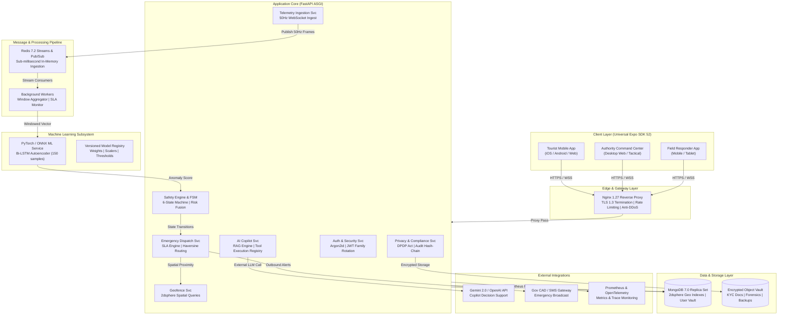
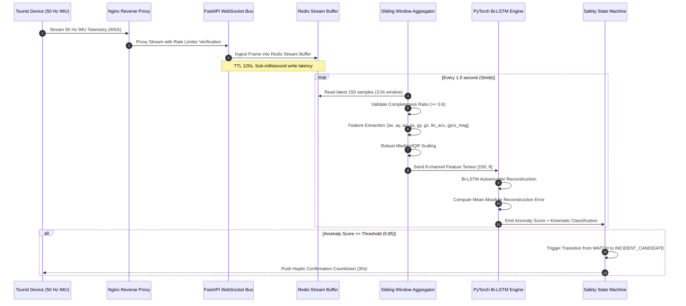
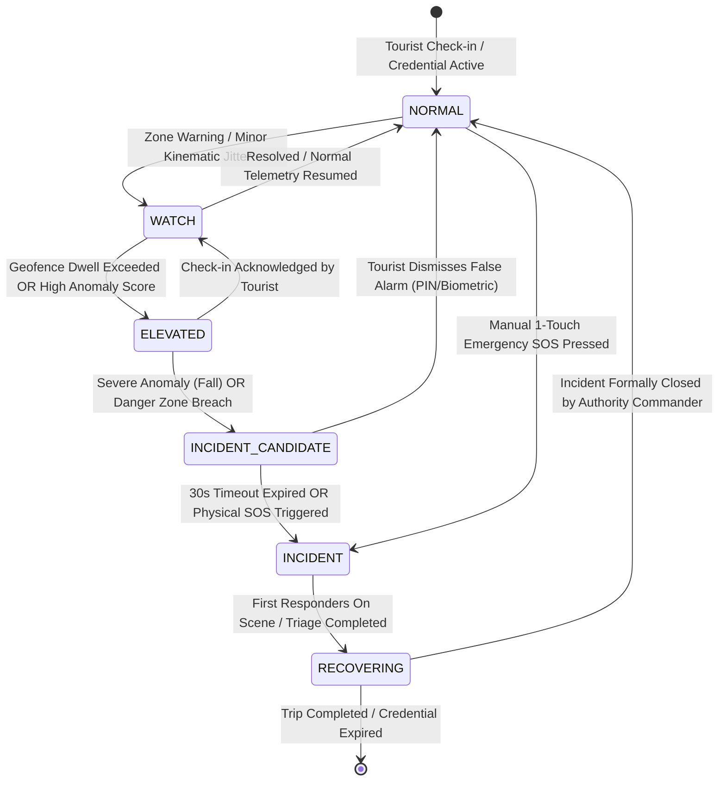
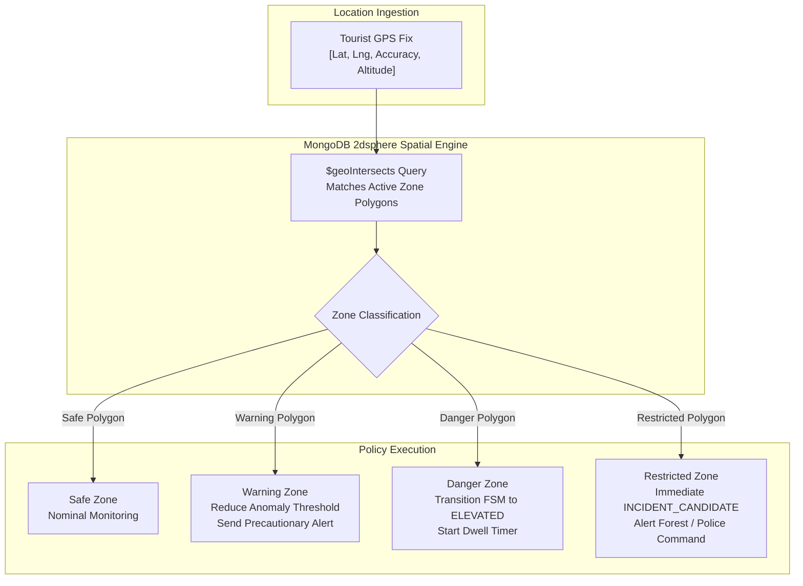
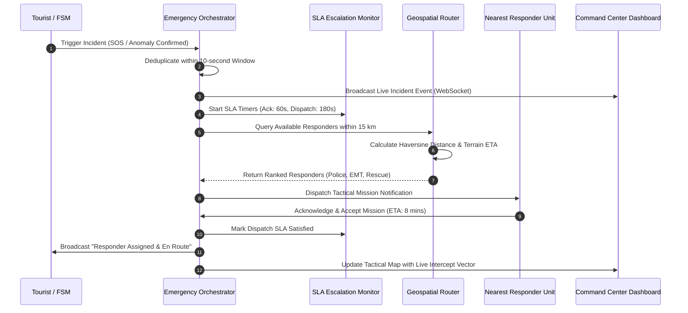
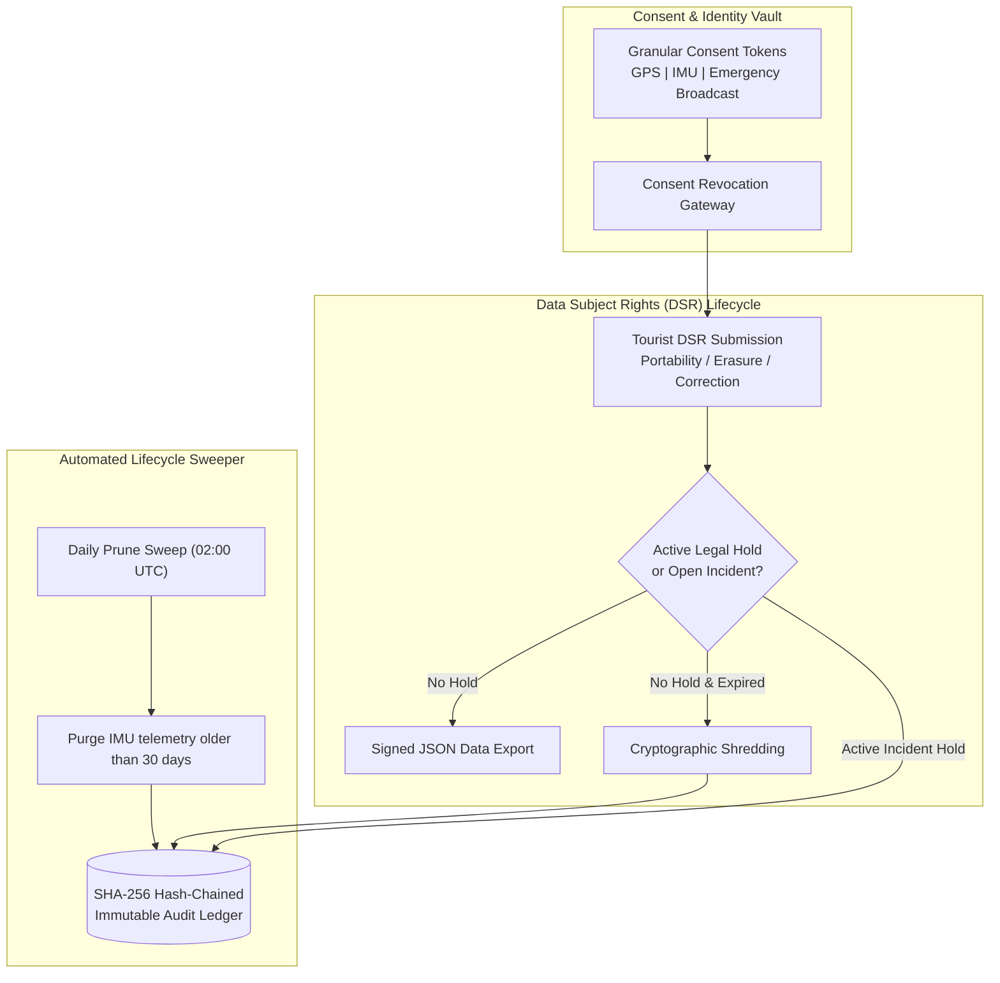
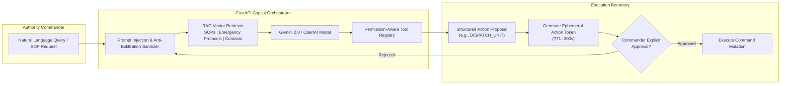
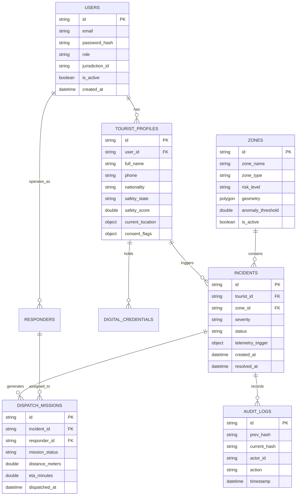

# TourSafe Technical Design Document (TDD)

> **Document Status**: Approved / Production Baseline  
> **System Name**: TourSafe B2G/G2C Tourist Safety & Incident Command Platform  
> **Version**: 1.0.0 (GA)  
> **Compliance Alignment**: DPDP Act 2023, ISO 27001:2022, SOC 2 Type II, NIST CSF  
> **Author**: TourSafe Engineering & Architecture Team  

---

## Executive Summary

TourSafe is an enterprise-grade Government-to-Government (B2G) and Government-to-Citizen (G2C) tourist safety and emergency response orchestration platform. It is engineered specifically for district tourism authorities, state police command centers, disaster response agencies, and international travelers.

The platform provides an end-to-end safety lifecycle encompassing:
1. **Cryptographic Identity**: W3C-compliant Verifiable Digital Tourist Credentials.
2. **Kinematic Anomaly Detection**: 50 Hz stream ingestion with PyTorch Bi-directional LSTM Autoencoder.
3. **Geospatial Geofencing**: MongoDB `2dsphere` spatial indexing with polygon containment and dwell detection.
4. **Multi-Signal Risk Fusion**: 6-state formal safety state machine evaluated by 9 deterministic safety rules.
5. **Multi-Agency Dispatch**: Haversine/ETA responder routing with automated SLA escalation.
6. **Sovereign Privacy**: DPDP Act 2023 compliance, cryptographic hash-chained immutable audit ledger, and automated retention sweeps.
7. **Grounded AI Copilot**: LLM decision support with Human-in-the-Loop action tokens and RAG.

---

## 1. High-Level System Architecture

The TourSafe architecture follows a defense-in-depth, decoupled microservices model optimized for low-latency telemetry ingestion, real-time spatial processing, and high availability.

---

## 2. High-Frequency Telemetry Ingestion Pipeline

The telemetry subsystem processes continuous inertial measurement unit (IMU) streams (accelerometer and gyroscope) at 50 Hz from tourist smartphones or wearable devices to detect physical trauma, high-g falls, vehicular impacts, or sudden immobility.

### Telemetry Pipeline Mathematical Specifications

- **Sampling Rate ($f_s$)**: 50 Hz (1 frame every 20 ms).
- **Window Size ($W$)**: 150 samples ($T = 3.0$ seconds).
- **Window Stride ($S$)**: 50 samples ($\Delta t = 1.0$ second).
- **Completeness Ratio ($C$)**:
  $$C = \frac{N_{\text{received}}}{W} \ge 0.60$$
- **Magnitude Computations**:
  $$\text{Linear Acceleration Magnitude } = \sqrt{a_x^2 + a_y^2 + a_z^2}$$
  $$\text{Angular Velocity Magnitude } = \sqrt{g_x^2 + g_y^2 + g_z^2}$$

---

## 3. Bi-directional LSTM Autoencoder ML Architecture

The anomaly detection engine relies on a Bi-directional Long Short-Term Memory Autoencoder trained exclusively on normal locomotion kinematics (walking, sitting, climbing stairs, leisurely movement). Anomalies (falls, collisions, collapses) fail reconstruction and yield high reconstruction error.

```mermaid
graph LR
    subgraph Input_Features ["Input Tensor [Batch, 150, 8]"]
        RawIn["8 Feature Channels<br/>50 Hz x 3 seconds"]
    end

    subgraph Encoder ["Bi-directional LSTM Encoder"]
        Enc1["Bi-LSTM Layer 1<br/>Hidden Size: 64 | Dropout: 0.2"]
        Enc2["Bi-LSTM Layer 2<br/>Hidden Size: 32"]
        Latent["Latent Bottleneck Vector<br/>Dimension: 16"]
    end

    subgraph Decoder ["Bi-directional LSTM Decoder"]
        Repeat["Repeat Vector (150 steps)"]
        Dec1["Bi-LSTM Layer 1<br/>Hidden Size: 32"]
        Dec2["Bi-LSTM Layer 2<br/>Hidden Size: 64"]
        TimeDist["TimeDistributed Dense<br/>Output Size: 8"]
    end

    subgraph Output_Scoring ["Reconstruction & Thresholding"]
        Reconstruction["Reconstructed Window [Batch, 150, 8]"]
        LossCalc["Reconstruction Error:<br/>MAE(Input, Output)"]
        Calibrator{"Threshold Check<br/>Normal < 0.40<br/>Warning 0.40 - 0.70<br/>Critical >= 0.85"}
    end

    RawIn --> Enc1 --> Enc2 --> Latent
    Latent --> Repeat --> Dec1 --> Dec2 --> TimeDist --> Reconstruction
    RawIn --> LossCalc
    Reconstruction --> LossCalc
    LossCalc --> Calibrator
```

---

## 4. Safety State Machine (FSM) & Multi-Signal Risk Fusion

TourSafe enforces a formally verified, deterministic 6-state safety lifecycle. Transitions are governed by probabilistic risk fusion combining kinematics, spatial geofencing, itinerary compliance, and weather hazards.

### Risk Fusion Matrix

$$R_{\text{total}} = w_1 R_{\text{IMU}} + w_2 R_{\text{Geo}} + w_3 R_{\text{Itinerary}} + w_4 R_{\text{Env}}$$

Where weights satisfy $\sum w_i = 1.0$:
- $w_1 = 0.40$ (Kinematic Anomaly Score)
- $w_2 = 0.35$ (Geospatial Danger Level & Dwell Ratio)
- $w_3 = 0.15$ (Itinerary Deviation & Off-Trail Tracking)
- $w_4 = 0.10$ (Environmental Risk / Extreme Weather)

---

## 5. Geospatial Geofence Architecture

TourSafe leverages MongoDB's native `2dsphere` geospatial indexing to perform sub-millisecond point-in-polygon and spherical distance calculations without external GIS engine overhead.

---

## 6. Emergency Dispatch & Incident Orchestration Flow

Upon confirmation of an incident, the emergency orchestration engine activates multi-agency dispatch with SLA monitoring.

---

## 7. Sovereign Privacy & DPDP Act 2023 Architecture

TourSafe complies with India's Digital Personal Data Protection (DPDP) Act 2023, ISO 27001, and GDPR through purpose-bound consent and immutable audit logging.

### Cryptographic Audit Ledger Hash-Chaining

Every administrative decision, dispatch action, or data access event is cryptographically linked to the previous entry:

$$H_n = \text{SHA-256}\left(H_{n-1} \,\|\, T_{\text{timestamp}} \,\|\, \text{ActorID} \,\|\, \text{ActionType} \,\|\, \text{PayloadDigest}\right)$$

Any retroactive tampering in the database breaks the hash chain, immediately alerting the compliance monitoring daemon.

---

## 8. Authority AI Copilot Architecture

The AI Copilot provides operational intelligence to incident commanders while enforcing strict permission boundaries and preventing unauthorized database mutation.

---

## 9. Database Model & Schema Architecture

MongoDB stores spatial geometries, telemetry aggregations, and relational incident documents.

---

## 10. Security Architecture & Threat Model

| Threat Category | Potential Attack Vector | TourSafe Defense-in-Depth Control |
|:---|:---|:---|
| **Identity Theft** | JWT theft & replay attacks | Refresh token rotation with automatic token family invalidation upon reuse detection. |
| **Credential Compromise**| Password database exfiltration | Argon2id memory-hard password hashing with per-user salt. |
| **Telemetry Spoofing** | Forged 50 Hz kinematic streams | Token-bound WebSocket sessions, jitter window analysis, and anomalous packet drop rate flags. |
| **Spatial Injection** | Malicious GeoJSON polygons | Strict Pydantic V2 GeoJSON polygon validation; coordinate bounding box sanity checks. |
| **SSRF** | Outbound webhook abuse targeting metadata | Anti-SSRF DNS resolution check blocking private IP ranges (`10.0.0.0/8`, `127.0.0.0/8`, `169.254.0.0/16`). |
| **Denial of Service** | Telemetry ingestion flooding | Multi-tier sliding window rate limiters (General: 50 req/s, Auth: 5 req/s, Telemetry: 100 req/s). |
| **Network Snooping** | Internal communication eavesdropping | Nginx TLS 1.3 edge termination; internal Docker/K8s network isolation with no external IP on DBs. |

---

## 11. Reliability & Fault Tolerance

1. **Circuit Breakers**: Outbound connections to external LLMs and notification gateways are guarded with circuit breakers (tripping after 5 consecutive failures with 30s half-open reset).
2. **Graceful Degradation**: If Redis Streams experience temporary degradation, telemetry ingestion falls back to local in-process sliding FIFO buffers.
3. **Database Probes**: `/health/liveness` and `/health/readiness` continuously verify MongoDB replica set writeability and Redis socket responsiveness.
4. **Disaster Recovery**: Automated nightly database snapshots with automated restore verification drills (`scripts/backup_restore_drill.py`).
